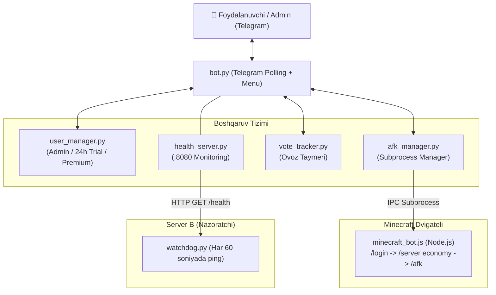

# 🚀 Minecraft Server Vote Reminder & 24/7 AFK Bot

Ushbu loyiha shaxsiy kompyuterni doimiy yoqib qo'ymasdan:
1. **Minecraft serveringiz uchun har 15 soatda ovoz berish vaqtini o'tkazib yubormaslik**;
2. **Minecraft serverga avtomatik kirib, `/server economy` ga o'tuvchi va `/afk` holatida 24/7 turuvchi AFK Bot**;
3. **Admin va pulli foydalanuvchilar obuna tizimi (1 kunlik sinov muddati va cheklangan faol slotlar)**;
4. **Ikki tomonlama server monitoringi (Watchdog)** bilan uzluksiz 24/7 ishlashini ta'minlash uchun ishlab chiqilgan.

---

## 📌 Asosiy Imkoniyatlar

### 1. 🎮 Minecraft 24/7 AFK Bot (Mineflayer Dvigateli)
- Har bir foydalanuvchi o'z o'yin niki va parolini kiritib, o'zining shaxsiy AFK botini ishga tushiradi.
- Serverga ulanadi va kerak bo'lsa `/login <parol>` yoki `/register` orqali tizimga kiradi.
- BungeeCord / Velocity orqali `/server economy` buyrug'ini yozadi va server almashganini tekshiradi.
- Economy serverga tushgach avtomatik `/afk` yozadi.
- **Anti-Kick**: Serverdan chiqarib yuborilmaslik uchun davriy ravishda yengil harakat qiladi (boshni burish, sakrash).
- **Auto-Reconnect**: Server o'chib-yonsa yoki uzilish bo'lsa, 10 soniyada qayta ulanadi.

### 2. 👑 Admin va Obuna Tizimi (Trial & Premium)
- **Super Admin**: Bot egasi (Admin ID) to'liq, bepul va cheksiz huquqqa ega.
- **Yangi foydalanuvchilar**: 1 kunlik (24 soat) bepul sinov (Trial) muddati beriladi.
- **Sinov muddati tugaganda**: Bot avtomatik to'xtaydi va Premium obuna talab qiladi.
- **Admin paneli**: `/grant <chat_id> <kunlar>` orqali foydalanuvchilarga obuna muddatini uzaytirish, `/users` orqali ro'yxatni ko'rish.
- **Slot cheklovi**: Server resurslarini tejash uchun bir vaqtning o'zida maksimal 1-2 ta faol bot ishlashi cheklangan.

### 3. 🗳 Ovoz Berish Eslatmasi (Vote Reminder)
- Har 15 soatda ovoz berish havolasi va tugmalar bilan eslatma yuboriladi.
- Saytdan olingan havoladagi vaqtni (`?error=2&time=...`) avtomatik tahlil qiladi.

---

## 🏗 Arxitektura



---

## ⚙️ Sozlash (Configuration)

1. Bog'liqliklarni o'rnating:
```bash
npm install
pip install -r requirements.txt
```

2. `.env` faylini sozlang:
```ini
TELEGRAM_BOT_TOKEN=your_bot_token_here
TELEGRAM_CHAT_ID=your_telegram_id_here
ADMIN_USER_IDS=your_telegram_id_here
MAX_ACTIVE_BOTS=2
DEFAULT_MC_HOST=mc.example.com
DEFAULT_MC_PORT=25565
DEFAULT_MC_SUBSERVER=economy
```

---

## 🚀 24/7 Ishga Tushirish

### 1-variant: Windows Kompyuterda (Fonda 24/7)
Oddiygina `run_24_7.bat` faylini ikki marta bosing. Agar bot qandaydir sabab bilan to'xtasa, skript uni 5 soniyada avtomatik qayta ishga tushiradi:
```cmd
run_24_7.bat
```
Yoki PM2 orqali:
```bash
pm2 start ecosystem.config.js
pm2 save
```

### 2-variant: Linux VPS / Docker orqali
```bash
docker compose up -d vote-bot
```

### 3-variant: Linux Systemd Xizmati orqali
```bash
sudo cp deploy/mc-vote-bot.service /etc/systemd/system/
sudo systemctl daemon-reload
sudo systemctl enable mc-vote-bot
sudo systemctl start mc-vote-bot
```

---

## 🤖 Telegram Bot Buyruqlari

### Umumiy & AFK Bot:
* `/start` — Asosiy menyu va hisob holati
* `/afk_start` — Minecraft AFK botni ishga tushirish
* `/afk_stop` — AFK botni to'xtatish
* `/afk_status` — Hozirgi holat va jonli loglar
* `/setnick [nik]` — O'yinchi niki
* `/setpass [parol]` — Server paroli (/login)
* `/setserver [ip] [port] [subserver]` — Minecraft server manzili

### Ovoz Berish (Vote):
* `/status` — Ovoz berish taymeri
* `/voted` — Ovoz berilganini qo'lda tasdiqlash
* `/vote` — Ovoz berish havolasi

### Faqat Admin uchun:
* `/admin` — Admin boshqaruv paneli va statistika
* `/grant [chat_id] [kunlar]` — Foydalanuvchiga obuna muddati berish
* `/users` — Barcha foydalanuvchilar va ularning obuna muddati

---

## 🧪 Testlarni Ishga Tushirish

Barcha 59 ta unit testlarni tekshirish uchun:
```bash
python -m unittest discover tests
```
